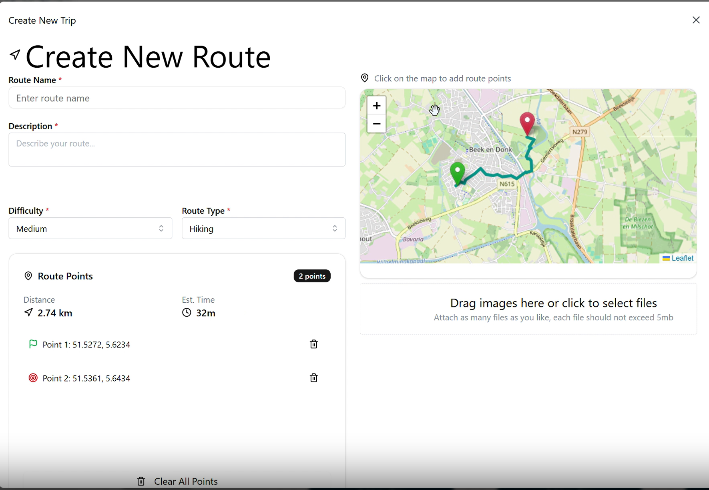

# DigiCompass

DigiCompass is a web application for discovering, creating and planning outdoor routes such as hikes, walks and runs. Users can browse routes shared by the community, check the weather for a route, save favourites, and build their own routes by clicking points on a map.

It is a full-stack project with a Spring Boot backend, a web frontend, and a containerised infrastructure (PostgreSQL/PostGIS, Redis, MinIO). Route calculation is provided by the GraphHopper API.

## Table of contents

- [Features](#features)
- [Screenshots](#screenshots)
- [Tech stack](#tech-stack)
- [Architecture](#architecture)
- [Project structure](#project-structure)
- [Getting started](#getting-started)
- [Configuration](#configuration)
- [Running the tests](#running-the-tests)
- [Documentation](#documentation)
- [Project management](#project-management)
- [Security notes](#security-notes)

## Features

- REST API with defined endpoints for the application's core functionality
- User sign-up with password hashing using **Argon2**
- JWT-based authentication
- Geospatial data storage with PostgreSQL + PostGIS
- Route calculation through the GraphHopper Routing API
- File/object storage via an S3-compatible service (MinIO)
- Automated database migrations with Flyway
- Automated tests (backend tests and Cypress end-to-end tests)

**For users**

- **Route discovery:** search routes and filter by type, difficulty level and distance, with tabs for All, Popular, Nearby and Saved routes
- **Route details:** each route shows its difficulty, distance, estimated duration, rating, description and photos
- **Create routes:** click points on an interactive map and the route, distance and estimated time are calculated automatically
- **Photo upload:** attach images to a route (max 5 MB per file)
- **Favourites:** save routes with the heart button
- **Weather check:** look up the weather for a route
- **Trip planning:** add routes to a trip
- **Profile and community:** user profile with bio, plus routes shared with the community

## Screenshots

### Dashboard

User profile and shared routes.


### Route discovery

Search, filter and save routes.


### Create a route

Click on the map to add route points. Distance and estimated time update automatically.



## Tech stack

| Layer | Technology |
|---|---|
| Backend | Spring Boot (Java), Spring Data, Flyway |
| Frontend | Web app served on port 5173 (`frontend/`) |
| Database | PostgreSQL 17 with PostGIS 3.5 |
| Cache | Redis 7 |
| Object storage | MinIO (S3-compatible) |
| Maps | Leaflet (interactive map), OpenStreetMap tiles |
| External API | GraphHopper Routing API |
| Auth | JWT, Argon2 password hashing |
| Testing | Cypress (end-to-end), backend tests |
| Containers | Docker and Docker Compose |

## Architecture

```
┌──────────┐     ┌──────────────┐     ┌──────────────────┐
│ Frontend │ ──▶ │   Backend    │ ──▶ │ PostgreSQL/PostGIS│
│  :5173   │     │  Spring Boot │     └──────────────────┘
└──────────┘     │    :8080     │ ──▶ Redis        :6379
                 │              │ ──▶ MinIO (S3)   :9000
                 │              │ ──▶ GraphHopper API (external)
                 └──────────────┘
```

The C4 diagrams (context, container, component) are in the [`Documents`](Documents) folder.

## Project structure

```
DigiCompass/
├── backend/               # Spring Boot API
├── frontend/              # Web frontend
├── Documents/             # Project plan, prototype, user stories, C4 diagrams
│   └── screenshots/       # Images used in this README
├── docker-compose.yml     # Local development stack
├── docker-compose-test.yml# Test stack
├── cypress.config.js      # Cypress configuration
└── .env.example           # Template for environment variables
```

## Getting started

### Prerequisites

- [Docker](https://docs.docker.com/get-docker/) and Docker Compose
- A free [GraphHopper API key](https://www.graphhopper.com/)
- Git

### Installation

1. **Clone the repository**

   ```bash
   git clone https://github.com/aleynamusa/DigiCompass.git
   cd DigiCompass
   ```

2. **Create your environment file**

   ```bash
   cp .env.example .env
   ```

   Open `.env` and fill in your own values (see [Configuration](#configuration)). Never commit this file.

3. **Start the stack**

   ```bash
   docker compose up --build
   ```

4. **Open the app**

   | Service | URL |
   |---|---|
   | Frontend | http://localhost:5173 |
   | Backend API | http://localhost:8080 |
   | MinIO console | http://localhost:9001 |

To stop everything: `docker compose down` (add `-v` to also delete the database and storage volumes).

## Configuration

The application is configured through environment variables, read from `.env` by Docker Compose.

| Variable | Description |
|---|---|
| `SPRING_DATASOURCE_URL` | JDBC URL of the PostgreSQL database |
| `SPRING_DATASOURCE_USERNAME` | Database user |
| `SPRING_DATASOURCE_PASSWORD` | Database password |
| `SPRING_DATASOURCE_URL_TEST` | JDBC URL of the test database |
| `SPRING_DATASOURCE_USERNAME_TEST` | Test database user |
| `SPRING_DATASOURCE_PASSWORD_TEST` | Test database password |
| `JWT_SECRET` | Secret used to sign JWTs. Use a long random value, e.g. `openssl rand -base64 32` |
| `GRAPHHOPPER_API_KEY` | Your GraphHopper API key |
| `MINIO_ROOT_USER` | MinIO admin user |
| `MINIO_ROOT_PASSWORD` | MinIO admin password |
| `DOCKERHUB_USERNAME` | Docker Hub account used when publishing images |

Example `.env.example` (placeholders only):

```env
DOCKERHUB_USERNAME=your-dockerhub-username
SPRING_DATASOURCE_URL=jdbc:postgresql://db:5432/digicompass
SPRING_DATASOURCE_USERNAME=postgres
SPRING_DATASOURCE_PASSWORD=change-me
JWT_SECRET=change-me-to-a-long-random-string
SPRING_DATASOURCE_URL_TEST=jdbc:postgresql://db_test:5432/digicompass_test
SPRING_DATASOURCE_USERNAME_TEST=postgres
SPRING_DATASOURCE_PASSWORD_TEST=change-me
GRAPHHOPPER_API_KEY=your-graphhopper-key
MINIO_ROOT_USER=change-me
MINIO_ROOT_PASSWORD=change-me-to-a-strong-password
```

## Running the tests

**Backend tests**

```bash
docker compose -f docker-compose-test.yml up --build
```

**End-to-end tests (Cypress)**

```bash
npm install
npx cypress open     # interactive
npx cypress run      # headless
```

## Documentation

Project documentation is kept in the [`Documents`](Documents) folder:

- Project plan
- Low-fidelity prototype
- User stories
- C4 diagram (context, container and component levels)

## Project management

Work is tracked on the [Jira board](https://musaaleyna1-1745492611172.atlassian.net/jira/software/projects/DIG/boards/1).

## Security notes

- Keep `.env` out of version control. Only `.env.example` should be committed.
- Use unique, strong credentials for the database and MinIO. Do not use default values outside local experiments.
- The Compose file is intended for local development. Before deploying, do not publish the database, Redis or MinIO ports to the host, remove the Java debug port (5005), pin image versions, and serve everything over HTTPS.
- To report a vulnerability, open a private security advisory on the repository's **Security** tab.

## Author

Created by [Aleyna Musa](https://github.com/aleynamusa).
